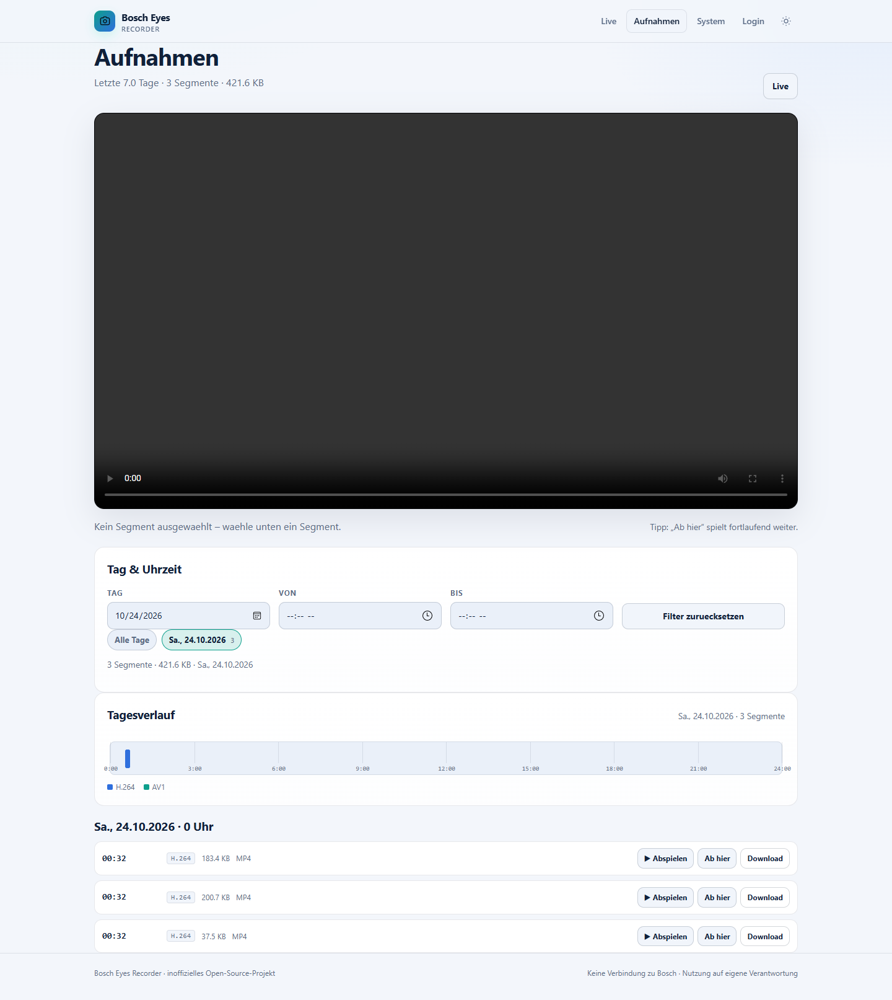

<div align="center">

# Bosch Eyes Recorder

**Docker/CapRover recorder and browser UI for Bosch Eyes (Gen1) cameras.**

Live HLS view with audio, one-time browser login, and continuous H.264/AAC
recording with rolling retention (default: 7 days) in a Docker volume.

[](https://github.com/Alfagun74/bosch-eyes-recorder/actions/workflows/ci.yml)
[](LICENSE)
[](https://www.python.org/)
[](Dockerfile)

</div>

> **Unofficial project.** Not affiliated with, endorsed by, or supported by
> Bosch Security Systems. Use at your own risk and make sure your use complies
> with applicable law, privacy rules, and the terms of the services you use.

---

## Contents

- [Why this project](#why-this-project)
- [Features](#features)
- [Architecture](#architecture)
- [Quick start](#quick-start)
  - [Option A: Docker Compose (recommended)](#option-a-docker-compose-recommended)
  - [Option B: CapRover + GitHub (alternative)](#option-b-caprover--github-alternative)
  - [Option C: Local development](#option-c-local-development)
- [First login](#first-login)
- [Configuration](#configuration)
- [Live view](#live-view)
- [Browse recorded footage](#browse-recorded-footage)
- [Endpoints](#endpoints)
- [Hardware transcoding (AV1/Opus, Intel QSV)](#hardware-transcoding-av1opus-intel-qsv)
- [Recordings and retention](#recordings-and-retention)
- [Storage sizing](#storage-sizing)
- [Security](#security)
- [Troubleshooting](#troubleshooting)
- [Limitations](#limitations)
- [Development](#development)
- [Repository layout](#repository-layout)
- [License and credits](#license-and-credits)

## Why this project

Bosch Eyes cameras only expose their video stream through a short-lived
("temporary") local credential, which the official Bosch Smart Home app
requests from the Bosch cloud and renews continuously. That makes continuous
local recording with common tools fragile: credentials expire every ~30
minutes, and Bosch's OAuth client does not allow password grants (login is
SingleKey ID in a browser, with captcha/MFA).

This project packages the missing glue into a single container:

- It signs in to the Bosch cloud with a refresh token created **once** through
  the browser.
- It renews the temporary camera credentials in the background.
- It pulls the camera stream over the Bosch RTSP-over-HTTPS tunnel with
  MediaMTX and records it **without re-encoding**.
- It deletes old segments so that only the configured retention window stays
  on disk.
- It serves a small web UI with a browser live view and an easy login flow.

The result: point it at your camera, log in once, and get the last N days of
video on your own server.

## Features

- **Live view in the browser** – HLS (H.264 + AAC) with a bundled hls.js
  player, served through the app on port `80`. No extra exposed ports.
- **One-time browser login** – start the login from the web UI, sign in with
  your Bosch/SingleKey ID account, paste the resulting callback URL back into
  the app. The app exchanges it (PKCE) and stores a rotating refresh token.
- **Continuous recording** – MediaMTX records the camera's original H.264/AAC
  tracks as fMP4 segments; no ffmpeg, no transcoding in the default mode.
- **Optional AV1/Opus hardware transcoding** – re-encode finalized segments on
  an Intel Arc GPU via **QSV** (`av1_qsv`) with Opus audio for much smaller
  recordings (WebM/MKV/MP4 output, browser playback included).
- **Browse past recordings in the UI** – list segments by day, play them in the
  browser (seekable, with audio), play continuously from any point, or download
  them.
- **Rolling retention** – default 7 days, configurable per day/segment;
  additional guards for maximum storage and minimum free disk space.
- **Automatic credential renewal** – refreshes camera credentials every ~20
  minutes and recovers if the camera connection drops.
- **CapRover/GitHub friendly** – `captain-definition` + Dockerfile, plus a
  GitHub Actions workflow that deploys every push to `main` to CapRover.
- **Multi-arch image** – builds for `amd64` and `arm64`.
- **Modern responsive web UI** – mobile-friendly dashboard, live player, recordings
  browser with **day/time filters and a timeline**, dark/light theme, and a
  dedicated system page.
- **Small surface** – status/health endpoints, JSON status, and structured
  logs; no database.

## Architecture

```text
                       ┌─────────────────────────── container ───────────────────────────┐
 Browser ── HTTP 80 ──▶ │ app: status_http (UI, /login, HLS proxy, /healthz, /status)     │
                       │   │                │                                             │
                       │   │ OAuth/refresh  │ reverse proxy /hls/<token>/…                 │
                       │   ▼                ▼                                             │
                       │ Bosch Cloud ──▶ MediaMTX ── RTSP-over-HTTPS ──▶ Camera (LAN)      │
                       │                     │                                        │
                       │                     ├── record → /data/recordings/eyes/*.mp4     │
                       │                     └── HLS muxer → 127.0.0.1:8888               │
                       └─────────────────────────────────────────────────────────────────┘
```

- `app/auth.py` – Bosch OAuth refresh-token lifecycle.
- `app/oauth.py` – PKCE browser-login flow used by the web UI.
- `app/cloud.py` – Bosch Residential API: camera lookup and temporary stream
  credentials, with TLS certificate pinning against the camera.
- `app/mediamtx.py` – generates the MediaMTX configuration, supervises the
  process, and reads its status API.
- `app/retention.py` – additional rolling deletion (age, max size, free disk).
- `app/status_http.py` – web UI, login endpoints, HLS proxy, health/status.
- `app/main.py` – orchestration: login → credentials → MediaMTX → watchdog.

See [docs/ARCHITECTURE.md](docs/ARCHITECTURE.md) for details.

## Quick start

### Prerequisites

1. A **Bosch Eyes (Gen1)** camera that is already paired with a Bosch account
   and online.
2. A server that can reach the camera's LAN IP on TCP `443` (for
   `CONNECTION_TYPE=LOCAL`), **or** set `CONNECTION_TYPE=REMOTE` to use the
   Bosch proxy (stream then goes through Bosch's cloud).
3. A browser for the one-time login.
4. A Docker volume with enough free space (see [Storage sizing](#storage-sizing)).
5. **Docker + Docker Compose** for the recommended installation path.

### Option A: Docker Compose (recommended)

Docker Compose is the recommended installation for a self-hosted server: one
checkout, one `.env` file, no external CI or CapRover required, automatic
container restart, and the same image as every other deployment path.

```bash
git clone https://github.com/Alfagun74/bosch-eyes-recorder.git
cd bosch-eyes-recorder
cp .env.example .env
# edit .env and set at least WEB_PASSWORD
docker compose up -d --build
```

Open `http://<server-ip>/` and continue with [First login](#first-login).
Recordings are stored in `./data/recordings/eyes/`.

Useful commands:

```bash
docker compose logs -f              # app + MediaMTX logs
docker compose down                 # stop, keep the ./data volume
git pull && docker compose up -d --build   # update to the latest version
docker compose up -d --force-recreate      # apply changed .env values
```

- The compose file reads `.env` automatically. `.env.example` documents the
  common settings; all options are listed in [Configuration](#configuration).
- If port 80 is already in use, change the host side of the `ports` mapping in
  `docker-compose.yml` (e.g. `"8080:80"`) and open `http://<server>:8080/`.
  The container port stays `80`.
- Set `WEB_PASSWORD` before exposing the app to a network. Without it, the UI
  and live stream are open to anyone who can reach the host.
- The image is rebuilt locally on first start and downloads a pinned MediaMTX
  release; the build machine needs Internet access.

For an Intel Arc GPU, add the QSV override (passes `/dev/dri` and enables
AV1/Opus transcoding):

```bash
docker compose -f docker-compose.yml -f docker-compose.qsv.yml up -d --build
```

See [Hardware transcoding](#hardware-transcoding-av1opus-intel-qsv) for details.

If you cannot use Compose, the equivalent command is:

```bash
docker build -t bosch-eyes-recorder .
docker run -d --name bosch-eyes-recorder --restart unless-stopped --init \
  -p 80:80 -v "$PWD/data:/data" --env-file .env \
  bosch-eyes-recorder:latest
```

### Option B: CapRover + GitHub (alternative)

Use this if you already run CapRover and prefer push-to-deploy. CapRover builds
the Docker image on the server, so Docker is not required on your workstation.
The Compose path above is the simpler default for most users.

#### 1. Create the CapRover app

CapRover → **Apps** → **Create New App** (e.g. `bosch-recorder`):

- **Container HTTP Port:** `80`
- **Persistent Directories:** add `/data`
- Optional: enable **HTTP Basic Auth** in CapRover as an extra layer in front
  of the app.

#### 2. Add the deployment secrets to your GitHub repository

CapRover → your app → **Deployment** → **Enable App Token** and copy the token.
Then in GitHub → repository → **Settings → Secrets and variables → Actions**,
add:

| Secret | Value |
|---|---|
| `CAPROVER_SERVER` | `https://captain.your-domain.com` |
| `CAPROVER_APP_NAME` | Name of your CapRover app |
| `CAPROVER_APP_TOKEN` | App token from the previous step |

The included workflow [`.github/workflows/deploy-caprover.yml`](.github/workflows/deploy-caprover.yml)
runs on every push to `main` (and can be started manually) and deploys the
committed source to CapRover. CapRover builds the Docker image on the server
using the included `Dockerfile` and `captain-definition`.

> The app-token deployment is asynchronous: a green action means CapRover
> accepted the deployment. Watch the build in CapRover, then open your app URL.
> Until the three secrets are configured, the deploy workflow is skipped with a
> notice (CI still runs).

#### 3. Set the runtime environment

CapRover → your app → **App Configs → Environmental Variables**:

```text
WEB_PASSWORD   = choose-a-strong-password
RETENTION_DAYS = 7
TZ             = Europe/Berlin
```

At minimum set `WEB_PASSWORD`; otherwise anyone with the app URL can watch the
camera and use the login page.

#### 4. Open the app and log in

Open `https://<your-app-domain>/`, click **"Sign in with Bosch"**, complete the
SingleKey ID login in the new tab, copy the full callback URL
(`http://localhost:8321/callback?...`) and paste it back into the app. The live
stream and the recording start automatically.

See [First login](#first-login) for details and alternatives.

### Option C: Local development

Run the app on the host (Python 3.11+ and a MediaMTX binary):

```bash
python -m venv .venv
. .venv/bin/activate        # Windows: .venv\Scripts\activate
pip install -r requirements.txt

# Download MediaMTX for your platform from
# https://github.com/bluenviron/mediamtx/releases and point to it:
export MEDIAMTX_BINARY=/path/to/mediamtx
export DATA_DIR=./data
export HEALTH_PORT=8080
python -m app.main
```

Open `http://127.0.0.1:8080/`. For tests and development notes see
[docs/DEVELOPMENT.md](docs/DEVELOPMENT.md).

## First login

Bosch's OAuth client (`oss_residential_app`) does **not** allow a password
grant. Login happens in a browser via SingleKey ID (with captcha/MFA if
enabled). The app supports this without running a browser automation stack:

1. Open `https://<your-app>/login`.
2. Click **"Sign in with Bosch"**. The app creates a PKCE verifier/state and
   redirects to the official Bosch login.
3. After successful login, the browser is redirected to the registered URL
   `http://localhost:8321/callback?...`. Because that local port is not the
   server, the browser shows a connection error — that is expected. **Copy the
   complete URL from the address bar.**
4. Return to the app's `/login` page (reload it if needed), paste the URL into
   the callback field, and submit.
5. The app validates `state`, exchanges the code together with its PKCE
   verifier, stores the refresh token in `/data/state/bosch_token.json`
   (mode 600), and starts the stream.

The refresh token is rotated by Bosch on every renewal; the app persists each
new token immediately. Do **not** use the same token in two instances at the
same time — Keycloak's refresh-token reuse detection can revoke the session.

**Alternative:** paste an existing refresh token on the login page, or set
`BOSCH_REFRESH_TOKEN` as an app environment variable. The refresh token is a
long-lived credential equivalent; treat it like a password. The optional
helper `tools/export_refresh_token.py` performs the browser flow on a
workstation if you cannot use the app's own login UI.

## Configuration

All configuration is via environment variables.

| Variable | Default | Description |
|---|---|---|
| `WEB_PASSWORD` | *(empty)* | Basic-auth password for the UI (user `admin`). Strongly recommended. |
| `RETENTION_DAYS` | `7` | Rolling retention in days (fractions allowed, min `0.05`). |
| `SEGMENT_MINUTES` | `10` | Recording segment length in minutes. |
| `TZ` | container default | Timezone for file names and logs (e.g. `Europe/Berlin`). |
| `HIGH_QUALITY` | `false` | `true` requests the camera's higher-quality profile (more bandwidth/storage). |
| `CONNECTION_TYPE` | `LOCAL` | `LOCAL` = direct LAN connection; `REMOTE` = Bosch proxy. |
| `BOSCH_CAMERA_ID` | *(empty)* | Camera ID if the account has multiple cameras. |
| `BOSCH_CAMERA_NAME` | *(empty)* | Partial camera title as an alternative selector. |
| `CAMERA_HOST` | *(empty)* | Override the camera host/IP used in the stream URL. |
| `BOSCH_REFRESH_TOKEN` | *(empty)* | Bootstrap refresh token (otherwise use the web login). |
| `MAX_STORAGE_GB` | `0` | Hard storage cap; oldest segments are deleted first. `0` disables. |
| `MIN_FREE_GB` | `5` | Delete oldest segments when free disk space drops below this. |
| `HEALTH_PORT` | `80` | Port the web UI/health server listens on inside the container. |
| `CREDENTIAL_REFRESH_SECONDS` | `1200` | How often temporary camera credentials are refreshed. |
| `STALL_SECONDS` | `90` | How long the stream may be down before new credentials are requested. |
| `LOG_LEVEL` | `INFO` | `DEBUG`, `INFO`, `WARNING`, `ERROR`. |
| `DATA_DIR` | `/data` | Root directory for state and recordings. |
| `MEDIAMTX_BINARY` | `mediamtx` | MediaMTX executable (in the image: `/usr/local/bin/mediamtx`). |
| `MEDIAMTX_API_ADDR` | `127.0.0.1:9997` | Internal MediaMTX API address. |
| `MEDIAMTX_HLS_ADDR` | `127.0.0.1:8888` | Internal MediaMTX HLS address. |
| `MEDIAMTX_RTSP_ADDR` | `127.0.0.1:8554` | Internal MediaMTX RTSP address (loopback only). |
| `TRANSCODE_ENABLED` | `false` | Enable AV1/Opus transcoding (requires QSV or a compatible FFmpeg build). |
| `TRANSCODE_CONTAINER` | `webm` | `webm`, `mkv`, or `mp4` output container. |
| `TRANSCODE_QUALITY` | `32` | QSV ICQ quality (lower = better/larger). |
| `TRANSCODE_PRESET` | `slow` | QSV preset. |
| `TRANSCODE_AUDIO_BITRATE` | `48k` | Opus audio bitrate. |
| `TRANSCODE_BITRATE` | *(empty)* | Optional target video bitrate instead of quality mode. |
| `TRANSCODE_EXISTING` | `true` | Transcode existing `.mp4` recordings too. |
| `TRANSCODE_MIN_AGE_SECONDS` | `30` | Minimum age of a segment before transcoding. |
| `TRANSCODE_DEVICE` | `/dev/dri/renderD128` | QSV render device. |
| `FFMPEG_BINARY` | `/usr/lib/jellyfin-ffmpeg/ffmpeg` | FFmpeg binary used for transcoding. |

Environment variables containing secrets (`WEB_PASSWORD`, `BOSCH_REFRESH_TOKEN`)
should be set as CapRover app secrets/environment values, not committed to git.

## Live view

The browser player uses HLS generated by MediaMTX and proxied by the app under
`/hls/<random-token>/eyes/index.m3u8`. HLS is robust through HTTP reverse
proxies and works in Chrome/Edge/Firefox via the bundled hls.js; Safari can
play it natively. Expect ~2–5 seconds latency.

The stream is muted by default because browsers block autoplay with sound;
use the player's volume control. If the stream is not ready yet, the dashboard
automatically refreshes until the camera source is up.

## Browse recorded footage

Open **`/recordings`** (linked from the dashboard) to browse the recordings
that are still inside the retention window:

- Segments are grouped by day and sorted newest first.
- **▶** plays a single segment in the embedded HTML5 player.
- **"Ab hier"** plays that segment and continues with the following (newer)
  segments in chronological order — useful to watch a contiguous period.
- **Download** saves a segment as-is. Segments can also be concatenated
  losslessly with `ffmpeg -f concat`.
- Only finalized segments are listed; the segment currently being written
  appears after `SEGMENT_MINUTES` (the last few seconds are intentionally
  hidden so you never see an incomplete file).
- Playback is the original camera stream (H.264/AAC, no transcoding) and
  supports seeking via HTTP Range requests.

There is also a JSON view at `/api/recordings` (for scripts/monitoring), and
media files are served under an unguessable token path
(`/media/<token>/eyes/….mp4`) so `<video>` elements work even with Basic auth.

## Endpoints

| Path | Purpose |
|---|---|
| `/` | Dashboard with live player and status |
| `/login` | Bosch browser login or refresh-token fallback |
| `/oauth/start`, `/oauth/finish` | Login flow endpoints |
| `/recordings` | Recording browser (list, player, download) |
| `/api/recordings` | Recording list as JSON |
| `/media/<token>/…mp4` | Segment playback (HTTP Range supported) |
| `/hls/<token>/eyes/index.m3u8` | Live HLS stream (used by the player) |
| `/healthz` | Healthcheck for Docker/CapRover |
| `/status` | Full JSON status |



## Hardware transcoding (AV1/Opus, Intel QSV)

By default MediaMTX records the camera stream **without re-encoding** (H.264 +
AAC). Optionally the container can re-encode every finalized segment to **AV1
via Intel QSV** and **Opus** audio, which drastically reduces storage on a
server with an Intel Arc GPU (DG2/A-series, e.g. **Arc A380**).

### Requirements

- Intel Arc A-series GPU with AV1 encode support (DG2), Linux kernel **6.2+**;
  Resizable-BAR is recommended (required for Arc B-series).
- Docker access to the GPU render node (`/dev/dri/renderD128`).
- The amd64 image already bundles **Jellyfin FFmpeg** (with `av1_qsv` +
  `libopus`) and the required Intel user-mode driver libraries. The arm64 image
  does **not** include transcoding support.
- Docker Compose (CapRover does not expose GPU devices; use the Compose path
  for QSV).

### Enable

```bash
cp .env.example .env
# set WEB_PASSWORD, optionally HIGH_QUALITY=true (recommended for better source quality)
docker compose -f docker-compose.yml -f docker-compose.qsv.yml up -d --build
```

The QSV override passes `/dev/dri` and sets `TRANSCODE_ENABLED=true`. Relevant
settings (in `.env`):

| Variable | Default | Description |
|---|---|---|
| `TRANSCODE_ENABLED` | `false` | Enable background AV1/Opus transcoding |
| `TRANSCODE_CONTAINER` | `webm` | `webm` (browser playback), `mkv` (VLC), `mp4` |
| `TRANSCODE_QUALITY` | `32` | QSV ICQ quality; lower = better/larger |
| `TRANSCODE_PRESET` | `slow` | QSV encoder preset |
| `TRANSCODE_AUDIO_BITRATE` | `48k` | Opus bitrate |
| `TRANSCODE_BITRATE` | *(empty)* | Use a target bitrate instead of quality |
| `TRANSCODE_EXISTING` | `true` | Also convert existing `.mp4` recordings |
| `TRANSCODE_MIN_AGE_SECONDS` | `30` | Only convert segments older than this |
| `TRANSCODE_DEVICE` | `/dev/dri/renderD128` | QSV render device |
| `RENDER_GID` | `109` | Host `render` group GID (see `getent group render`) |

### How it works

1. MediaMTX keeps writing the original `.mp4` segments (max. one segment of
   loss on crashes).
2. A background worker converts each finalized segment with FFmpeg:
   `av1_qsv` + `libopus` (`-global_quality 32 -preset slow` by default).
3. The original is deleted only after a successful transcode. Until then, the
   original remains playable in `/recordings`.
4. The UI lists both `.mp4` (H.264) and `.webm`/`.mkv` (AV1) segments; the
   encoding card on the dashboard shows progress and saved bytes.

> **Segments without audio:** some camera segments carry an audio stream
> descriptor but no audio packets. The worker probes the segment and encodes
> those video-only; if Opus still fails, it retries without audio. A failed
> transcode never deletes the original recording.

> **Note:** Re-encoding an already heavily compressed low-quality camera stream
> (for example ~0.17 Mbit/s with `HIGH_QUALITY=false`) cannot shrink it
> dramatically without visible quality loss. For meaningful savings, set
> `HIGH_QUALITY=true` so the camera provides a higher-quality source, then let
> the A380 encode AV1. Test with a few segments and compare size/quality.

### Verify the GPU in the container

```bash
docker compose -f docker-compose.yml -f docker-compose.qsv.yml exec bosch-recorder \
  ffmpeg -hide_banner -encoders | grep -E 'av1_qsv|libopus'

docker compose -f docker-compose.yml -f docker-compose.qsv.yml exec bosch-recorder \
  vainfo --display drm --device /dev/dri/renderD128
```

Then watch the logs (`docker compose ... logs -f`) and the **Kodierung** card on
the dashboard. If the encoder is missing or the device is inaccessible, the
worker reports the error and **keeps the original recordings** — recording is
never blocked by transcoding.

### Playback

WebM (AV1 + Opus) plays in current Chrome, Edge and Firefox; Safari may not
support WebM/Opus. Use `TRANSCODE_CONTAINER=mkv` and VLC/ffmpeg if you need
maximum player compatibility, or `mp4` for AV1-in-MP4 containers.

## Recordings and retention

Recordings are fMP4 segments (`.mp4`) written by MediaMTX:

```text
/data/
  recordings/eyes/
    2026-01-31_23-10-02-283092.mp4   # segment start timestamp (local timezone)
  state/
    bosch_token.json                 # refresh token (mode 600)
    mediamtx.yml                     # generated config (contains temporary camera credentials!)
    last_status.json                 # last status snapshot
```

- Segment length: `SEGMENT_MINUTES` (default 10).
- Retention: MediaMTX deletes recordings older than `RETENTION_DAYS`
  (`recordDeleteAfter`); the app additionally prunes every 5 minutes and
  enforces `MAX_STORAGE_GB` / `MIN_FREE_GB`.
- A container restart can lose at most the currently written segment; earlier
  segments are finalized and playable.
- Segments can be played directly with VLC/ffmpeg or concatenated losslessly
  (`ffmpeg -f concat -safe 0 -i list.txt -c copy out.mp4`).

## Storage sizing

Measured in tests with `HIGH_QUALITY=false` and a very static night scene:
~**0.17 Mbit/s** (a 61-second segment was 1.32 MB). Video content, scene
activity, quality profile, and audio affect this significantly. Plan
conservatively:

| Bitrate (video + audio) | Per day | 7 days |
|---|---|---|
| 0.5 Mbit/s | ~5.4 GB | ~38 GB |
| 1 Mbit/s | ~10.8 GB | ~76 GB |
| 2 Mbit/s | ~21.6 GB | ~151 GB |
| 4 Mbit/s | ~43.2 GB | ~302 GB |
| 8 Mbit/s | ~86.4 GB | ~605 GB |

Set `MIN_FREE_GB` (and optionally `MAX_STORAGE_GB`) so the container never
fills the volume. For better image quality, try `HIGH_QUALITY=true` and measure
the actual bitrate on your camera before sizing the volume.

## Security

- **Set `WEB_PASSWORD`** (or put CapRover HTTP Basic Auth in front). Without
  it, the live stream and UI are publicly reachable.
- The Bosch refresh token is equivalent to a long-lived login. It is stored in
  `/data/state/bosch_token.json` (mode 600) and must never appear in logs,
  screenshots, issues, or backups.
- `/data/state/mediamtx.yml` contains temporary camera credentials because
  MediaMTX needs them; protect the volume.
- The HLS proxy path contains an unguessable token, but the UI itself is the
  access control boundary.
- The camera stream does not transit Bosch's cloud with `CONNECTION_TYPE=LOCAL`;
  only the temporary credentials are requested from Bosch.
- For public deployments, use HTTPS (CapRover provides it) and CapRover's Basic
  Auth as a second layer. See [SECURITY.md](SECURITY.md).

## Troubleshooting

See [docs/TROUBLESHOOTING.md](docs/TROUBLESHOOTING.md) for a complete list.
Common cases:

| Symptom | Fix |
|---|---|
| `need_setup` / no stream | Log in via `/login`; verify the app can reach Bosch's cloud. |
| Login callback rejected | Copy the complete `http://localhost:8321/callback?...` URL including `code` and `state`. |
| `path_ready=false` for a long time | Camera offline, privacy mode on, or camera not reachable from the server; check `docker logs` and `CONNECTION_TYPE`. |
| No audio | Unmute the player; check the camera audio setting. |
| Browser asks for credentials | `WEB_PASSWORD` is set: user `admin`, your configured password. |
| A recording does not play | It may be the segment currently being written; wait until the next segment starts. Older segments play in VLC or via the Download link. |
| Disk filling up | Lower `RETENTION_DAYS`/`MAX_STORAGE_GB`, raise `MIN_FREE_GB`, enlarge volume. |

## Limitations

- **Bosch cloud dependency:** New temporary credentials always require Bosch's
  cloud. An existing recording continues if the cloud/Internet briefly
  disappears, but a new camera connection cannot be established until the
  cloud is reachable again. Fully offline/cloud-free operation is not possible
  with this camera generation.
- **One Bosch token per container:** Do not run two instances with the same
  token. Use a separate browser login per instance.
- **Bosch can change its API/client at any time.** This is an unofficial
  integration; pin/upgrade the project when Bosch changes the app.
- **Tested hardware:** Bosch Eyes Gen1 (SVO-1601-220, firmware 7.91.56) with
  `CONNECTION_TYPE=LOCAL`. Other models/firmware may work but are not verified.
- **Optional transcoding needs hardware.** AV1/Opus via QSV requires an Intel
  Arc GPU, `/dev/dri` access, a recent kernel, and Docker Compose. The default
  mode records the original camera codecs as-is; storage sizing then follows
  the camera bitrate. This project was not tested on an A380 during CI (CI has
  no GPU); verify the encoder on your server.

## Development

```bash
python -m venv .venv
. .venv/bin/activate
pip install -r requirements.txt
pip install ruff
ruff check app tools tests
python -m unittest discover -s tests -v
python -m compileall -q app tools
```

For a local end-to-end run see [docs/DEVELOPMENT.md](docs/DEVELOPMENT.md). CI
runs linting, unit tests (Python 3.11/3.12), and a Docker build on every push
and pull request.

## Repository layout

```text
app/                 application code
  static/            bundled hls.js player
docs/                architecture, login, troubleshooting, development docs
tests/               unit tests (no camera/network required)
tools/               optional refresh-token helper
.github/workflows/   CI and CapRover deployment workflows
Dockerfile           multi-arch image (Python + pinned MediaMTX)
captain-definition   CapRover build definition
docker-compose.yml   recommended Docker Compose setup
docker-compose.qsv.yml optional Intel QSV/AV1 override
.env.example         documented environment template for Compose
```

## License and credits

MIT licensed — see [LICENSE](LICENSE) and [NOTICE.md](NOTICE.md).

This project was inspired by and reuses a few public constants and the CA
certificate from the MIT-licensed
[mosandlt/bosch-camera-tool](https://github.com/mosandlt/bosch-camera-tool).
It bundles [hls.js](https://github.com/video-dev/hls.js) (Apache-2.0) and
downloads [MediaMTX](https://github.com/bluenviron/mediamtx) (MIT) at image
build time. Bosch, Bosch Smart Home, SingleKey ID, and Bosch Eyes are
trademarks of their respective owners. This project is not affiliated with
Bosch.

---

<details>
<summary><strong>Deutsch (Kurzfassung)</strong></summary>

Docker-Container für CapRover, der den Stream einer Bosch-Eyes-Gen1-Kamera
dauerhaft aufnimmt (Standard: 7 Tage rollierend) und eine Weboberfläche auf
Port 80 mit Browser-Livebild (HLS) sowie einfachem Bosch-Login bereitstellt.
Aufnahmen liegen im Volume unter `/data/recordings/`; die Kamera wird per
RTSP-over-HTTPS angebunden, ohne Re-Encoding. Einmalig über `/login` mit dem
Bosch-Konto anmelden (Browser) und die Callback-URL zurück in die Oberfläche
kopieren. `WEB_PASSWORD` setzen. Details auf Englisch in dieser README und in
`docs/`.

</details>
